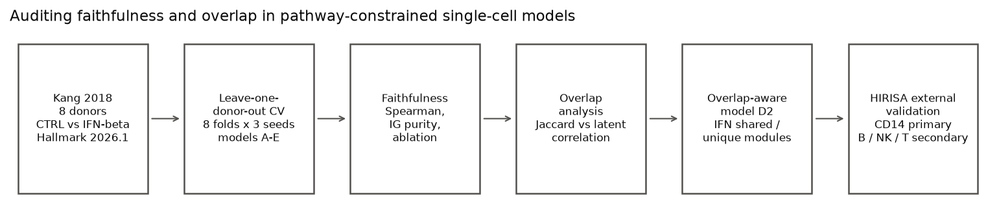
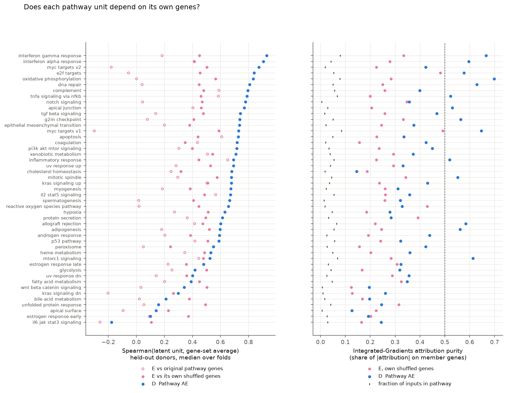
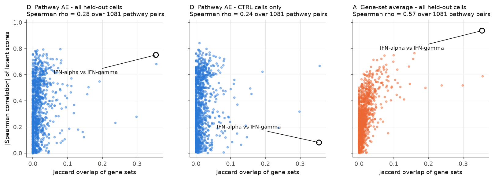
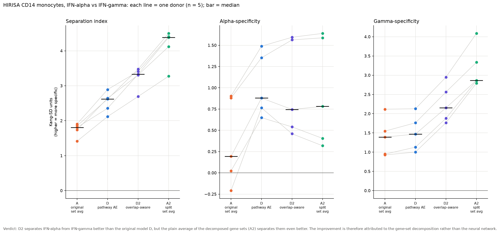
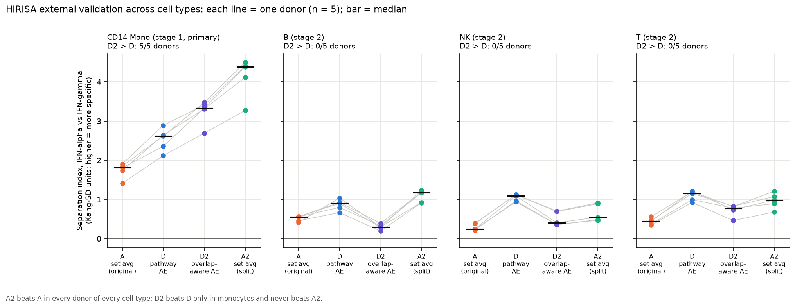

# Auditing Faithfulness and Overlap in Pathway-Constrained Single-Cell Models

**Live interactive demo:** [single-cell-pathway-interpretability.streamlit.app](https://single-cell-pathway-interpretability.streamlit.app/)

Neural models with an underlying pathway-constrained design are often read as though each latent variable stands for the biological pathway it is labelled with. This project aims to test that assumption.

I use donor-held-out single-cell RNA-seq data to check whether pathway-labelled latent variables actually reflect their assigned genes, whether overlap between pathways leads to latent entanglement, and whether splitting the interferon gene sets into shared and unique components improves specificity on an independent dataset.

The pathway-constrained latent variables turn out to be informative but only partially faithful. Latent correlation is associated with gene-set overlap, and splitting the overlapping interferon gene sets improves external specificity. However, the neural overlap-aware model is not consistently better than a simple average over the split gene sets.



## Research questions

The project addresses three related questions:

1. If a latent unit carries a pathway name, does it depend mainly on the genes from that pathway?
2. Does overlap between pathway gene sets contribute to correlation, or entanglement, between pathway-labelled latent variables?
3. If the overlapping interferon pathways are split into shared and pathway-specific genes, does specificity improve on independent data?

I am not trying to propose a new autoencoder architecture. The project focuses on testing the biological interpretation of pathway-constrained representations.

## Data

### Kang 2018

The internal analysis uses the Kang single-cell interferon dataset:

- 8 donors
- CTRL and interferon-stimulated cells
- 24,562 cells after the main QC filter
- leave-one-donor-out evaluation
- MSigDB Hallmark 2026.1.Hs pathways

A cell type qualifies for the pathway-response analysis if at least 6 of the 8 donors in the dataset have at least 20 CTRL and 20 stimulated cells.

### HIRIS-Atlas / GSE306664

For external validation, I use HIRIS-Atlas / GSE306664, an independent dataset containing several interferon stimulation conditions.

The primary validation is a balanced design in CD14 monocytes:

- 5 donors
- unstimulated
- IFN-alpha
- IFN-beta
- IFN-gamma
- 20 files in total

The stage-1 files contain **262,408 QC-passing cells in total**. The pre-specified primary analysis uses **236,314 CD14-monocyte cells** and **2,016 genes** shared with the final Kang transfer representations.

I evaluate B, NK and T cells separately as a secondary replication.

The external sample design and decision rules were fixed in advance, before any HIRIS-Atlas data were scored.

## Representations

| Model | Description |
|---|---|
| A | Simple pathway gene-set average |
| B | PCA baseline |
| C | Unrestricted autoencoder |
| D | Pathway-constrained autoencoder with a non-negative masked decoder |
| E | Pathway control with shuffled gene identities |
| D2 | Overlap-aware pathway autoencoder |
| A2 | Simple average of the overlap-aware shared/unique gene sets |

The shuffled control E retains the pathway sizes and the full pairwise overlap structure of the real pathway mask while randomizing the assigned gene identities.

In D2, the original Hallmark IFN-alpha and IFN-gamma pathways are replaced with:

- `IFN_SHARED`
- `IFNA_UNIQUE`
- `IFNG_UNIQUE`

## Experimental design

### Donor-held-out evaluation

Every internal model comparison uses 8-fold leave-one-donor-out cross-validation.

In each fold:

- 1 donor is held out for testing
- 1 donor is used for validation
- the other 6 donors are used for training
- gene filtering and scaling are fitted on the training donors only
- neural models are trained with 3 random seeds

### Faithfulness tests

I checked pathway-label faithfulness in several ways:

- Spearman correlation between a latent unit and the average expression of its assigned genes
- Integrated Gradients attribution purity
- ablating the pathway genes compared with ablating a size-matched random set of non-member genes
- the input genes with the highest attribution

Low attribution purity does not necessarily imply that the assigned genes are irrelevant. For some units, ablating the pathway genes has a much larger effect than random ablation, even though the latent variable correlates weakly with the simple pathway average.

### Overlap analysis

For each pair of pathway units, I measured gene-set overlap using Jaccard similarity and compared it with the absolute Spearman correlation between the two latent scores.

I ran this analysis on:

- all held-out cells
- CTRL cells only

Comparing the two helped separate the effect of pathway overlap from co-activation caused by cell stimulation.

### External specificity

For HIRIS-Atlas, I froze the Kang-derived representations and scaler and applied them to the external data without retraining.

I summarize interferon specificity for each donor as:

`SEP = alpha-specificity + gamma-specificity`

where:

- alpha-specificity compares the alpha unit under type-I stimulation with its value under IFN-gamma stimulation
- gamma-specificity compares the gamma unit under IFN-gamma stimulation with its value under type-I stimulation

The primary H5 comparison is D2 against D in CD14 monocytes, using IFN-alpha vs IFN-gamma.

I consider a comparison supported if the first representation performs better in at least 4 of 5 donors and the median donor-level difference is positive.

## Main results

### 1. Pathway units are informative but only partially faithful

For model D:

- median attribution purity across pathways: **0.372**
- **70%** of pathways have a median attribution purity below 0.5
- median Spearman correlation between a latent unit and its own gene set: **0.673**
- no pathway has a median pathway/random ablation ratio <= 1

The shuffled control is less faithful to its own shuffled genes:

- D, own real genes: **0.673**
- E, own shuffled genes: **0.455**
- E, original biological pathway genes: **0.201**

This fits a partial-faithfulness reading. The pathway labels should not be treated as exact mechanistic identities.



### 2. Pathway overlap is associated with latent entanglement

For model D, across held-out cells:

- Spearman rho between Jaccard overlap and absolute latent correlation: **0.279**
- median absolute correlation for pathway pairs that overlap: **0.390**
- median absolute correlation for pairs that do not overlap: **0.235**

The association is still present in CTRL cells:

- rho = **0.237**

For comparison:

- simple gene-set average A: rho = **0.569**
- shuffled control E: rho = **0.150**

In the original model D, the IFN-alpha and IFN-gamma latent units correlate as follows:

- all cells: Spearman **0.752**
- CTRL-only cells: Spearman **0.081**

So both pathway overlap and co-activation under perturbation appear to contribute to the apparent entanglement.



### 3. The IFN-alpha response is robust across held-out donors

The IFN-alpha unit in model D is positive in every eligible donor/cell-type combination and ranks among the top three pathways in every eligible cell type.

The simple pathway average A meets the same criterion, so I treat this as a sanity check. It does not imply that the neural model is better.

### 4. Overlap-aware decomposition changes specificity without improving reconstruction

D and D2 have almost identical held-out reconstruction error:

- D mean held-out MSE: **0.9404**
- D2 mean held-out MSE: **0.9403**

The overlap-aware decomposition changes how the interferon units are interpreted, but it does not materially change overall reconstruction performance.

### 5. External validation: the decomposition generalizes better than the neural improvement

In the primary HIRIS-Atlas CD14 monocyte analysis:

| Comparison | Donors better | Median SEP difference | Criterion |
|---|---:|---:|---|
| D2 vs D | 5/5 | +0.666 | met |
| D2 vs A | 5/5 | +1.519 | met |
| D2 vs A2 | 0/5 | -0.996 | not met |
| A2 vs A | 5/5 | +2.498 | met |

So D2 does improve on D in monocytes, but the much simpler A2 representation does better still.



In the secondary B, NK and T cell analyses, the D2 > D effect does not generalize:

| Cell type | D2 vs D | A2 vs A | D2 vs A2 |
|---|---:|---:|---:|
| B | 0/5 | 5/5 | 0/5 |
| NK | 0/5 | 5/5 | 0/5 |
| T | 0/5 | 5/5 | 0/5 |

Across cell types, the simple shared/unique decomposition gives the more consistent result.



## Interpretation

The results support four conclusions:

1. A pathway label does not guarantee mechanistic faithfulness at the pathway level.
2. Overlap between pathways contributes to correlated latent representations.
3. Separating interferon genes into shared and unique components improves external specificity.
4. The gene-set decomposition explains the improvement more consistently than the neural network does.

That is why I treat interpretability as something to test rather than something guaranteed by the architecture.

## Repository structure

```text
single-cell-pathway-interpretability/
├── .streamlit/
├── data/
│   ├── folds/
│   ├── gene_sets/
│   └── hirisa/
├── docs/
├── figures/
├── results/
├── src/
├── tests/
├── website/
├── .gitignore
├── README.md
└── requirements.txt
```


## Data sources and citations

This project is a secondary analysis of publicly available single-cell
RNA-seq datasets. No new participant data were collected.

### Kang et al. 2018

The internal analysis uses the Kang et al. PBMC interferon-beta dataset
(GEO: GSE96583). The processed `kang_2018.h5ad` object used here is the
scverse/PertPy version of the dataset.

Kang HM, Subramaniam M, Targ S, et al. Multiplexed droplet single-cell
RNA-sequencing using natural genetic variation. Nature Biotechnology.
2018;36:89-94. https://doi.org/10.1038/nbt.4042

Data: NCBI Gene Expression Omnibus, GSE96583.

### HIRIS-Atlas

External validation uses the publicly released HIRIS-Atlas dataset:

Moss N, Sakai C, Kaul S, et al. Revealing differential type I and type II
IFN responses in different immune cells in various human diseases by a new
IFNs transcriptomic atlas. NCBI Gene Expression Omnibus, GSE306664.
BioProject PRJNA1303123.

At the time of this analysis, the GEO record did not list an associated
publication.

### MSigDB Hallmark gene sets

Pathway definitions are from the human MSigDB Hallmark collection,
release v2026.1.Hs.

Subramanian A, Tamayo P, Mootha VK, et al. Gene set enrichment analysis:
a knowledge-based approach for interpreting genome-wide expression profiles.
PNAS. 2005;102:15545-15550.
https://doi.org/10.1073/pnas.0506580102

Liberzon A, Birger C, Thorvaldsdóttir H, et al. The Molecular Signatures
Database (MSigDB) hallmark gene set collection. Cell Systems.
2015;1:417-425.
https://doi.org/10.1016/j.cels.2015.12.004

MSigDB releases v2022.1 and later are distributed under the Creative
Commons Attribution 4.0 International license. The files in
`data/gene_sets/` are derived representations of MSigDB Hallmark gene sets.
`hallmark_membership.csv` converts the source GMT membership to tabular
form, and `overlap_aware_membership.csv` additionally replaces the original
IFN-alpha and IFN-gamma sets with shared and pathway-specific components.

## Reproducing the analysis

### 1. Create the environment

The local reproduction used Python 3.13.

```bash
python -m venv .venv
```

Activate the environment and install the pinned dependencies:

```bash
pip install -r requirements.txt
```

### 2. Add the raw Kang and Hallmark inputs

The files should be at:

```text
raw/kang/kang_2018.h5ad
raw/msigdb/h.all.v2026.1.Hs.symbols.gmt
```

### 3. Prepare Kang and the pathway definitions

```bash
python src/01_prepare_kang.py
python src/02_prepare_gene_sets.py
python src/03_make_donor_folds.py
```

### 4. Train donor-CV models

```bash
python src/04_train_donor_cv.py --models C
python src/04_train_donor_cv.py --models D
python src/04_train_donor_cv.py --models E

python src/08_build_overlap_variant.py
python src/04_train_donor_cv.py --models D2
```

### 5. Evaluate faithfulness and overlap

```bash
python src/05_evaluate_donor_cv.py
python src/06_attribute_latents.py
python src/07_analyze_overlap.py
python src/13_qc_sensitivity.py
python src/15_low_faithfulness_units.py
python src/19_shuffled_control_faithfulness.py
```

### 6. Train final Kang models for HIRIS-Atlas transfer

The genes shared between HIRIS-Atlas and Kang are listed in:

```text
data/hirisa/kang_hirisa_shared_genes.csv
```

Train the final D/D2 models on the shared input space only:

```bash
python src/10_train_final_kang.py   --restrict-genes data/hirisa/kang_hirisa_shared_genes.csv   --out models/final_hirisa
```

The number of final epochs is taken from the best epochs in the locally reproduced donor CV; it is not hard-coded.

### 7. Prepare and score HIRIS-Atlas stage 1

The exact external files are listed in:

```text
data/hirisa/download_stage1.csv
data/hirisa/stage1_file_verification.csv
```

Put the verified files in:

```text
raw/hirisa/stage1/
```

Then run:

```bash
python src/09_prepare_hirisa.py
python src/11_external_validation.py
python src/16_external_report.py
```

### 8. Run stage 2

The stage-2 download and verification manifests are:

```text
data/hirisa/download_stage2.csv
data/hirisa/download_stage2_verification.csv
```

Put the verified files in:

```text
raw/hirisa/stage2/
```

Then run:

```bash
python src/17_external_stage2.py
python src/18_external_stage2_report.py
```

### 9. Generate the combined summary and figures

```bash
python src/14_results_summary.py
python src/12_make_figures.py
```

Figures 8 and 9 come from the external-report scripts.

## Key output files

```text
results/results_summary.md
results/low_faithfulness_units.md
results/external/external_results.md

results/tables/donor_cv_performance.csv
results/tables/attribution_purity.csv
results/tables/overlap_latent_association.csv
results/tables/hirisa_external_response.csv
results/tables/hirisa_specificity.csv
results/tables/hirisa_stage2_specificity.csv

figures/fig1_project_design.png
...
figures/fig9_hirisa_all_cell_types.png
```

## Reproducibility notes

- Internal neural models are evaluated with donor-held-out cross-validation using 3 network seeds (0, 1, 2).
- The final neural models for external transfer use one fixed seed after the training length is chosen from donor CV.
- During donor CV, gene filtering and scaling are fitted only on the relevant training data.
- HIRIS-Atlas is scored using the frozen Kang scaler and models, with no retraining on the external data.
- Input hashes and exact software versions should be checked before reproducing the final tables.
- Small numerical differences can occur across PyTorch, BLAS and CPU environments, particularly in neural early stopping and downstream probe classifiers.

## Limitations

- The pathway-constrained decoder places no limit on which genes the encoder uses to compute a latent score.
- Hallmark pathways overlap substantially, so the pathway labels are not statistically or biologically independent.
- The internal Kang analysis has only one interferon perturbation, so on its own it cannot establish type-I versus type-II specificity.
- HIRIS-Atlas differs from Kang in assay platform, donor population and stimulation design.
- The primary external analysis has five donors and relies on a pre-specified rule based on donor counts and the median instead of inferential p-values.
- A single final network seed represents the neural model used for external transfer.
- Differences between cell types in stage 2 are descriptive and are not taken as evidence for any specific biological mechanism.

## Summary

The main takeaway:

> **A pathway-constrained decoder can reconstruct pathway genes well without guaranteeing that the corresponding latent unit is driven mainly by those genes.**

The pathway constraints do give meaningful representations, yet many latent units were only partially faithful to their pathway labels. Gene-set overlap contributes to entanglement, and the overlap-aware interferon decomposition improved specificity on independent data. However, the simplest version of that decomposition generalized more consistently than the neural model did.
